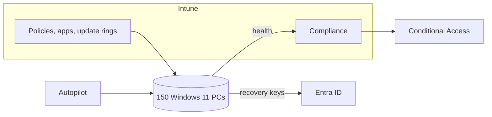

# Intune Endpoint Management for a 150-PC Windows Fleet

A practical plan for moving about 150 Windows PCs from manual management to Microsoft Intune. It covers software deployment, security policy, BitLocker, compliance, Windows updates, device inventory, remote wipe and configuration policy. It includes the scripts and procedures to run it.

It is written for a head office plus project sites, with uneven internet and a small IT team.

## What it solves

- New PCs are set up by hand and no two are the same
- Nobody knows how many PCs are encrypted or patched
- Updates depend on users restarting
- A lost laptop is a data risk

## How it fits together



## Read in this order

1. [Design and setup](docs/01-design-and-setup.md)
2. [Enrollment](docs/02-enrollment.md)
3. [Security policy, compliance and BitLocker](docs/03-security-policy.md)
4. [Windows updates and apps](docs/04-updates-and-apps.md)
5. [Inventory, operations and rollout plan](docs/05-inventory-and-operations.md)
6. [Lost device and remote wipe](docs/06-lost-device-and-wipe.md)

## Scripts

They use the Microsoft Graph PowerShell SDK and your own admin sign-in. They create things **unassigned**, so nothing reaches a PC until you assign it.

| Script | Does |
|---|---|
| `00-Connect-Graph.ps1` | Connect with the scopes the scripts need |
| `01-New-IntuneGroups.ps1` | Create device and ring groups |
| `02-New-CompliancePolicy.ps1` | Create the compliance baseline |
| `03-New-UpdateRings.ps1` | Create three update rings |
| `04-Export-DeviceInventory.ps1` | Export inventory and a health summary |
| `05-Get-BitLockerEscrowReport.ps1` | List PCs with no recovery key saved |
| `06-Invoke-DeviceAction.ps1` | Sync, rotate keys, retire or wipe one PC |

```powershell
Install-Module Microsoft.Graph -Scope CurrentUser
. .\scripts\00-Connect-Graph.ps1
.\scripts\01-New-IntuneGroups.ps1 -WhatIf
```

Other folders: `policies/` (JSON for compliance and update rings) and `apps/_template/` (Win32 app scripts).

## Status

Version 0.1. This is a design and a set of scripts. It is not a report of a production migration.

What was tested is listed in [docs/lab-validation-log.md](docs/lab-validation-log.md). Microsoft changes settings and Graph property names often, so check them against current documentation. Use a lab or trial tenant first.

## Author

Mehedi, enterprise IT infrastructure, Dhaka, Bangladesh. Microsoft 365, Azure and endpoint management. Certifications: MS-102, MD-102, AZ-104, AZ-305, AZ-400.

Corrections are welcome as issues or pull requests.

## License

[MIT](LICENSE)
